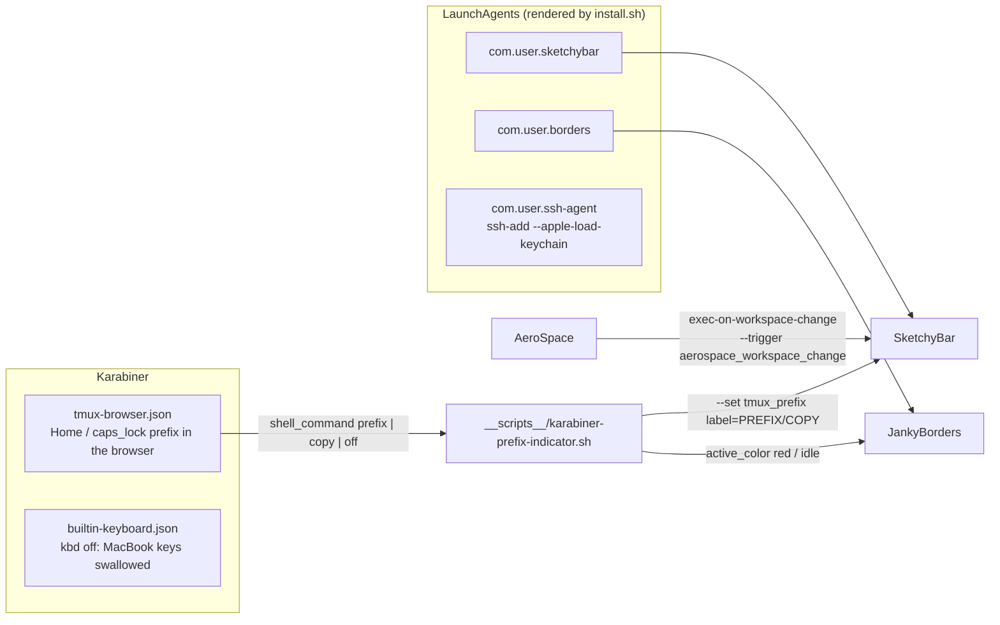
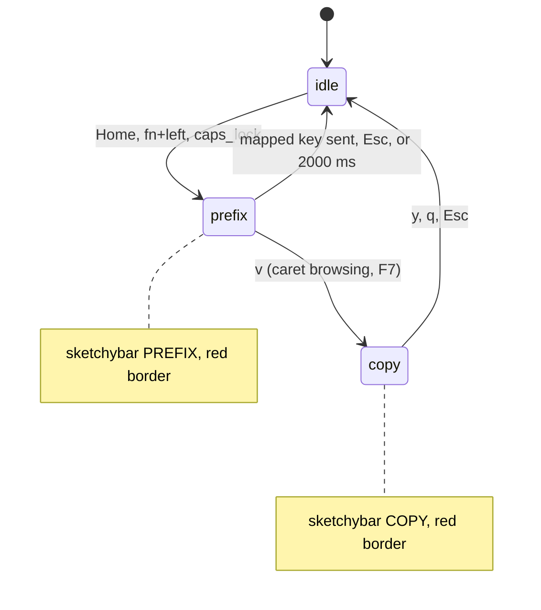
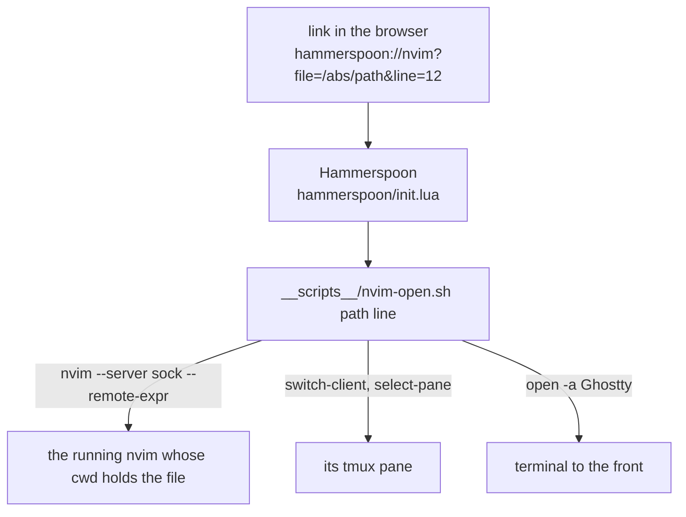
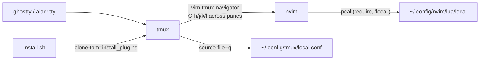

# Desktop (macOS)

Only darwin gets this stack. On Linux none of it is stowed.

## How the pieces talk



| Piece | Config | Started by |
|---|---|---|
| AeroSpace | `aerospace/aerospace.toml` | `start-at-login = true` |
| SketchyBar | `sketchybar/sketchybarrc` | LaunchAgent |
| JankyBorders | `borders/bordersrc` | LaunchAgent |
| Karabiner rules | `karabiner/*.json` | merged by `install.sh`, see below |
| Hammerspoon | `hammerspoon/init.lua` | open it once, then "Launch at login" in its preferences |

`install.sh` writes the plists but never runs `launchctl load`; they start at next login.

## Browser prefix layer



The rules are **not** stowed. `install.sh` and `dots-sync` (so every `git pull`, through the post-merge hook) merge them into `karabiner.json`. After editing a rule locally, apply it directly:

```bash
bash __scripts__/install_karabiner_rules.sh
```

Key map, copy-mode keys and design notes: [karabiner/README.md](../karabiner/README.md).

## Built-in keyboard switch

```bash
kbd off      # the MacBook's own keys stop doing anything
kbd on       # back
kbd status   # the default with no argument
```

For when an external keyboard sits on top of the laptop, or the laptop needs a
wipe. Nothing else is touched: trackpad, external keyboards and everything plugged
in keep working.

`builtin-keyboard.json` swallows the built-in keyboard while the Karabiner
variable `builtin_keyboard_disabled` is `1`; `__scripts__/builtin-keyboard.sh` is
the only thing that sets it, and `zsh/.functions` wraps it as `kbd`. The variable
is never written to disk, so quitting Karabiner, logging out or rebooting gives
the keyboard back. Details and the way out when no second keyboard is connected:
[karabiner/README.md](../karabiner/README.md).

## Browser link to nvim

Neovim has no URL scheme, so a web page cannot open a file in it directly. Hammerspoon registers one and hands the file to `__scripts__/nvim-open.sh`.



With no nvim running, the script opens one in a new tmux window. The browser asks once before it hands a link to Hammerspoon.

For fate-studio:

```sh
fate-studio --editor-url "hammerspoon://nvim?file={path}&line={line}"
```

The script also works alone, on Linux too, for any tool that can run a command: `nvim-open.sh <path> [line]`.

## Terminal



| Piece | Entry |
|---|---|
| tmux | `tmux/tmux.conf`; plugins via tpm (sensible, resurrect, continuum, vim-tmux-navigator, minimal-tmux-status, urlview, yank) |
| nvim | `nvim/init.lua` then `arisjirat.core`, `arisjirat.lazy` (lazy.nvim) |
| terminals | font and window only, no shell or tmux wiring |
